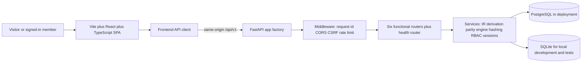
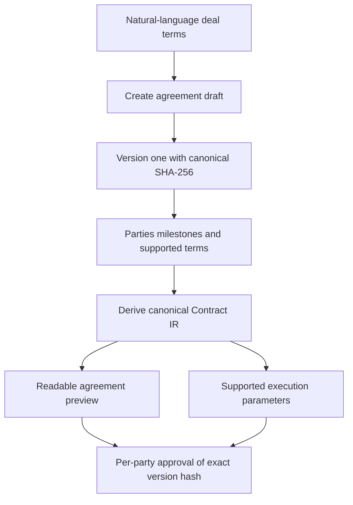
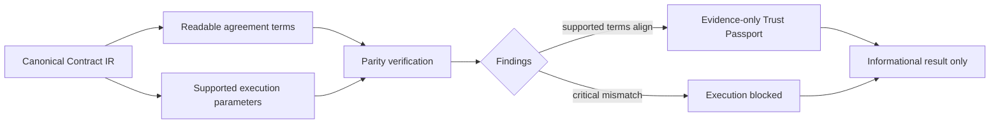
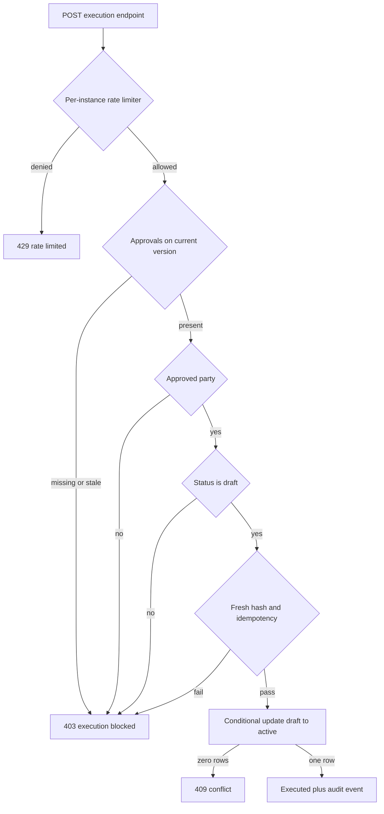

# L E G A L X

**LEGALX** — a LEXORA prototype for hackathon presentation.

> **Official branding:** the LEGALX name is set as a typographic wordmark. There is no separate logo asset; the identity is the wordmark plus an inline SVG mark used in the application shell.

---

## Product tagline

**Verify the agreement. Then execute.**

LEGALX turns a plain-language agreement into a canonical **Contract IR**, checks legal-to-code **parity** between the signed terms and the parameters that would control execution, issues an **evidence-only Trust Passport**, and enforces an **off-chain execution gate**. It is precise about what is real and what is simulated: consistency is verified; enforceability is never claimed.

> **Honesty boundary.** LEGALX verifies *consistency between representations* — not legal correctness, enforceability, or liability outcomes. A parity result of `passed` is informational only and **never** grants execution. See [Verified features](#verified-features), [Real, simulated, and deferred functionality](#real-simulated-and-deferred-functionality), and the [Final Master Report](docs/final-delivery/FINAL_MASTER_REPORT.md).

---

## HackIndia 2026, LEXORA, and PS-03

| Field | Value |
| --- | --- |
| Event context | HackIndia 2026 |
| Team / product | LEXORA — LEGALX |
| Presentation problem statement | PS-03 |
| Participant ID | HI025038 |

HackIndia 2026 and PS-03 are the **presentation and submission context** for this prototype. This repository does **not** contain an event-issued PS-03 specification or any in-repo requirement attributed to the event; no such requirement is asserted here. The seven filenames under `docs/final-delivery/` are owner-specified deliverable labels, not numbered product phases. See [Phase 12 — Hackathon](docs/final-delivery/PHASE_12_HACKATHON.md).

---

## The problem: legal language and executable logic drift apart

A signed agreement is written in prose. The parameters that would govern an executable representation live in a different form. Nothing forces the two to stay in agreement, and each can look correct on its own while the money does not reconcile between them. A deal can be *approved* and still not mean what was *encoded*.

### The canonical five-thousand-rupee disagreement

The jury-facing illustration on the public homepage is a client agreeing to pay a developer **₹30,000** in **3 × ₹10,000** milestones, while the proposed executable specification encodes a total of **₹35,000**:

| Representation | Value |
| --- | --- |
| Agreed deal | ₹30,000 |
| Milestone schedule | 3 × ₹10,000 = ₹30,000 |
| Encoded agreement total | ₹35,000 |
| **Mismatch** | **₹5,000** |

**Illustrative example only.** This story is a static, labelled illustration defined in `src/components/ContractStory.tsx` (lines 5–10). It is not a live verification result and not evidence of a transaction; the live two-field verification contract derives all amounts server-side and cannot construct this figure. It is deliberately distinct from the separate **₹50,000** demo-workflow constant, and the two are never conflated.

---

## The actual solution

1. **Derive a canonical Contract IR** from the natural-language terms, with canonical SHA-256 hashing.
2. **Check parity** between the readable agreement and the supported execution parameters using a real Python parity engine.
3. **Surface findings** — a critical mismatch blocks the execution path.
4. **Gate execution** on approvals of the exact version hash, the approved party, draft state, a fresh hash, idempotency, and an audit event.
5. **Issue a Trust Passport** that is re-derived server-side: hashes, versions, engine version, and status as technical evidence only.

A clean parity result is still subject to the approval gate, an organization-scoped authorization check, and a human decision. Parity and hashing prove *consistency*, never *enforceability*. See [Parity Engine](#parity-engine), [Trust Passport](#trust-passport), and [Backend architecture](#backend-architecture).

---

## Verified features

Labels follow the project's status vocabulary: **VERIFIED** = executed and evidenced; **SIMULATED** = labelled fixture or local demo control; **DEFERRED / BLOCKED** = not implemented or gated on an owner decision.

| Capability | Classification | Evidence / boundary |
| --- | --- | --- |
| Public site, guest demo, light-default theme, reduced motion, 3D hero treatment | **VERIFIED** | Source plus rendered-UI baseline; rehearsed 30/30 pages across 5/5 roles |
| Sessions, CSRF, RBAC, org-scoped 404, strict schema, one error envelope | **VERIFIED** | Backend suite (447 passed / 3 skipped / 1 warning); [docs/API.md](docs/API.md) |
| Agreements, versions, approvals, milestones, activity, canonical hashing | **VERIFIED** | 15 real HTTP routes; version and agreement test modules |
| Parity engine, strict two-field verify, append-only runs, evidence-only Trust Passport | **VERIFIED** | Parity test modules; parity E2E 10 passed / 0 failed / 0 skipped |
| Execution gate, idempotency, 403 / 409 / 429 branches | **VERIFIED** | Execution tests; rate-limit tests |
| Rate limiting on verify and execution | **VERIFIED** | Per-instance in-memory limiter; owner-accepted documented limitation |
| Deterministic extraction, document preview, tamper / restore demo fixtures | **SIMULATED** | Labelled fixtures; no live extraction service in the request path |
| Smart-contract and test-network workspace records | **SIMULATED** | UI records only; no wallet, signature, or transaction |
| Five-role demo switcher | **SIMULATED** | Local UI control; not production identity binding |
| Managed storage, server-side AI provider, private upload, IR package, Passport export | **DEFERRED** | Roadmap items; no HTTP surface claimed |
| Wallet lifecycle, on-chain indexing, real escrow | **DEFERRED / OUT OF SCOPE** | Excluded by owner decision and repository audit |
| Live hosted deployment and managed Postgres | **VERIFIED (Preview)** | Vercel Preview + Neon Postgres live; Alembic + demo seed applied; hosted E2E passed |
| MIT or any license grant | **BLOCKED** | Proposal only; see [Contributors and license](#contributors-and-license) |
| Jury submission PDF | **DOES NOT EXIST** | No file is asserted or fabricated |

The authoritative HTTP surface is **15 real routes**. There is **no** review, tamper, verify-execution, IR, `prepare`, webhook, wallet, or on-chain endpoint. See [API reference](#api-reference).

---

## Real, simulated, and deferred functionality

**Real and verified.** The Vite/React application, guest golden path, server-side sessions with argon2 hashing and cookie + CSRF protection, five-role server-computed authorization, organization-scoped access control, agreement and version lifecycle, approvals bound to exact version hashes, activity logging, canonical hashing, the Python parity engine, append-only verification records, the evidence-only Trust Passport, and the off-chain execution gate with idempotency and a conditional update.

**Simulated and labelled.** AI-style extraction is a deterministic fixture with no live provider in the verification path. The tamper/restore demonstration, document preview, and test-network workspace records are labelled simulation. The role switcher is a **local demo-only** control, not production identity binding. Identity binding (for example, a swapped counterparty) is advisory and deferred.

**Deferred, blocked, or out of scope.** The Vercel Preview deployment with managed Neon Postgres is live and full-stack verified; Production promotion still requires explicit owner approval. A jury PDF and an active license do not exist. **On-chain execution, Solidity deployment, wallet integration, MetaMask, real escrow, and on-chain indexing are OUT OF SCOPE** by decision and audit; no transaction, mainnet, or real-funds claim is made. No professional security audit, WCAG conformance, or legal-enforceability guarantee is claimed.

---

## System architecture

The browser talks to a single FastAPI application over same-origin `/api/v1` routes. Client-supplied roles, user IDs, and organization IDs are never trusted; protected routes re-check authentication and authorization server-side.



See [docs/ARCHITECTURE.md](docs/ARCHITECTURE.md) and [Backend architecture](#backend-architecture).

---

## GitHub-compatible Mermaid diagrams

All diagrams in this README use standard Mermaid `flowchart` syntax with quoted node labels, so they render on GitHub without additional configuration. Four diagrams are included: the [system architecture](#system-architecture) above, plus the IR flow, parity flow, and execution gate below.

### Contract IR flow



### Parity to findings to Trust Passport



### Approval to off-chain execution gate



---

## Project directory structure

```text
.
├── api/
│   ├── app/
│   │   ├── main.py              FastAPI factory, middleware, error envelope, router registration
│   │   ├── config.py            Settings from environment; production requires PostgreSQL
│   │   ├── db.py                Database session/engine wiring
│   │   ├── deps.py              Auth and permission dependencies
│   │   ├── routers/             health, auth, agreements, versions, activity, execution, parity
│   │   ├── models/              SQLAlchemy domain models (auth and agreements, verification)
│   │   ├── schemas/             Strict Pydantic request/response schemas, including parity.py
│   │   ├── parity/              engine.py, comparison_rules.py, canonicalization.py,
│   │   │                        execution_parameters.py, result_schema.py, version_binding.py,
│   │   │                        service.py, ir/derive.py
│   │   ├── intelligence/        Deterministic extractor, parsing, evidence, evaluation,
│   │   │                        prompting, provider abstractions, dataset.json
│   │   ├── rbac.py              Role definitions and server-computed permissions
│   │   ├── security.py          argon2 hashing, session and CSRF helpers
│   │   ├── ratelimit.py         Per-instance in-memory limiter
│   │   ├── approvals.py         Approval rules bound to version hashes
│   │   ├── hashing.py           Canonical hashing helpers
│   │   ├── errors.py            Uniform API error envelope
│   │   ├── validation.py        Shared validation helpers
│   │   ├── seeds.py             Demo seed entry point (python -m api.app.seeds)
│   │   └── timeutil.py          Time and expiry helpers
│   ├── alembic/
│   │   ├── env.py               Alembic environment; reads DATABASE_URL
│   │   └── versions/
│   │       └── e25c7211a088_initial_migration.py   Single revision, 15 tables
│   ├── tests/                   pytest suite, including parity, IR, execution, RBAC, CSRF
│   └── requirements.txt         Backend dependencies
├── src/
│   ├── App.tsx                  Application shell and page routing
│   ├── main.tsx                 React entry point; light theme default
│   ├── PublicStory.tsx          Public story presentation
│   ├── backend-pages.tsx        Authenticated application pages
│   ├── rbac.ts                  Client-side role presentation (server remains authoritative)
│   ├── hash.ts / integrity.ts / workflow-integrity.ts / traceability.ts
│   ├── solidity.ts              Illustrative contract-generation helpers; no deployment
│   ├── api/                     client.ts, config.ts, index.ts, types.ts
│   ├── components/              ui.tsx, ContractStory.tsx, FilmHero.tsx, Sculpture.tsx,
│   │                            Walkthrough.tsx, contract-story.css
│   ├── features/contract-ir/    ContractIR.tsx
│   └── styles/                  styles.css, theme.css, design.css, controls.css,
│                                landing.css, astra-layout.css, walkthrough.css
├── docs/
│   ├── final-delivery/          FINAL_MASTER_REPORT.md and PHASE_07 … PHASE_12 reports
│   ├── API.md / ARCHITECTURE.md / SECURITY.md / DATABASE.md / RBAC.md / TESTING.md
│   ├── OMEGA_FRS.md / STATE.md / DECISIONS.md / PRD.md / PRODUCT_ROADMAP.md
│   ├── SETUP.md / DEPLOYMENT.md / VERCEL_DEPLOYMENT.md / VERCEL_CONFIG_VALIDATION.md
│   ├── TRUST_LAYER.md / INTEGRITY_AND_HASHING.md / THREAT_MODEL.md
│   ├── LICENSING_REVIEW.md / proposed-LICENSE.md / MEDIA_PROVENANCE.md
│   ├── audit/ and audits/       Historical audit and engineering records
│   └── rehearsals/              latest.json, final-checklist.json
├── e2e/                         Playwright specs and environment helpers
├── scripts/                     Node test and demo-rehearsal scripts
├── public/                      fonts/, noir/, film/, manus-routes.json
├── alembic.ini                  Root Alembic config, script_location = api/alembic
├── vercel.json                  Two-service Vercel configuration
├── vite.config.ts / vite.parity.config.ts
├── playwright.config.ts / playwright.parity.config.ts
├── package.json / package-lock.json / pytest.ini
└── README.md
```

---

## Technology stack

| Layer | Technology |
| --- | --- |
| Frontend | React + TypeScript + Vite 8 |
| Backend | FastAPI, SQLAlchemy 2, Alembic (Python 3.11) |
| Database | PostgreSQL in deployment; SQLite for local development and tests |
| Security | argon2 password hashing, cookie sessions with CSRF tokens, server-side RBAC across five roles |
| Parity / IR | Real Python libraries with unit-test coverage |
| 3D treatment | Three.js hero treatment in `src/components/Sculpture.tsx`; visual only, not a legal-analysis feature |
| Testing | pytest, Playwright, Node workflow and rehearsal scripts |

---

## Frontend architecture

The single application shell in `src/App.tsx` serves public storytelling and five permission-aware journeys. React component primitives live in `src/components/ui.tsx`; the canonical IR view lives in `src/features/contract-ir/ContractIR.tsx`; all backend calls pass through `src/api/client.ts`. Story content, including the illustrative ₹30,000 / ₹35,000 case, is rendered by `src/components/ContractStory.tsx`.

Styles are organized under `src/styles/` (`styles.css`, `theme.css`, `design.css`, `controls.css`, `landing.css`, `astra-layout.css`, `walkthrough.css`) in the Astra Noir art direction. **Light is the default theme; dark is a persisted preference.** Motion is restrained and respects reduced-motion preferences. The Three.js sculpture is a separately bundled visual treatment, not part of the legal analysis.

`src/rbac.ts`, `src/hash.ts`, `src/integrity.ts`, and `src/workflow-integrity.ts` support presentation and integrity affordances; server-side checks remain authoritative. `src/solidity.ts` contains illustrative generation helpers only — no deployment, wallet, or transaction is performed.

---

## Backend architecture

The API is organized into **six functional routers** under `/api/v1` — `auth`, `agreements`, `versions`, `activity`, `execution`, and `parity` — plus the unprefixed `health` router mounted at `/api/health`: seven registered routers in `api/app/main.py` and **15 HTTP routes** in total. Cross-cutting middleware assigns a request ID, applies configured CORS, and enforces rate limits; an `ApiError` handler produces one error envelope for every failure path.

Supporting modules provide sessions and CSRF (`security.py`), five-role authorization (`rbac.py`), organization scoping and permission dependencies (`deps.py`), approval rules bound to version hashes (`approvals.py`), canonical hashing (`hashing.py`), strict Pydantic schemas (`schemas/`), and SQLAlchemy models (`models/`). Parity work is isolated in `api/app/parity/`; deterministic extraction in `api/app/intelligence/`.

There are **no review, tamper, verify-execution, IR, `prepare`, webhook, wallet, or on-chain endpoints**. See [API reference](#api-reference) and [docs/API.md](docs/API.md).

---

## Database design and migrations

The initial migration `e25c7211a088` is the **single revision** and creates **15 domain tables**:

`organizations`, `users`, `memberships`, `sessions`, `agreements`, `agreement_versions`, `agreement_parties`, `milestones`, `version_approvals`, `activity_events`, `idempotency_keys`, `ir_documents`, `execution_parameters`, `parity_runs`, `verification_runs`.

The model encodes organization scoping, the five allowed role values, version-bound approvals, append-only verification records, and idempotency keys. Alembic is configured from the root `alembic.ini` with `script_location = api/alembic`; `api/alembic/env.py` reads `DATABASE_URL` from the environment. There is no `create_all` in the application startup path.

Local development and tests use SQLite; deployment targets an external **Neon PostgreSQL** database. With `APP_ENV=production`, configuration hard-rejects any non-PostgreSQL database URL. Migration execution against a managed target is gated on owner provisioning. See [Database setup](#database-setup) and [docs/DATABASE.md](docs/DATABASE.md).

---

## Contract IR

The canonical Contract IR is the intermediate representation that connects readable legal terms to supported execution parameters. It is derived by real Python code (`api/app/ir/derive.py` with `api/app/schemas/ir.py`), canonicalized with SHA-256, and stored per agreement version alongside its execution parameters. Every verification run re-derives results server-side from stored rows rather than trusting client-supplied values.

Extraction into IR today is a **deterministic fixture**: there is no live AI provider in the verification request path and no AI-extraction HTTP route. A future production IR package is deferred. See [docs/ARCHITECTURE.md](docs/ARCHITECTURE.md) and [docs/TRUST_LAYER.md](docs/TRUST_LAYER.md).

---

## Parity Engine

The Parity Engine compares the readable agreement terms with supported execution parameters and produces findings. Its HTTP entry point is `POST /api/v1/agreements/{id}/versions/{version}/verify`, guarded by the `verification:run` permission with organization-scoped 404 behavior and rate limiting.

The live request body is deliberately strict: exactly two fields, `dispute_behavior` and `governing_law`, with `extra="forbid"`. Clients cannot override agreed amounts, milestones, or parties; those are derived from stored agreement rows. Results are appended to verification tables in a single transaction, and a Trust Passport is reconstructed from them.

> **`passed` is INFORMATIONAL.** It is a consistency signal only and **never grants execution**. The execution gate remains a separate technical control with its own approval, state, and concurrency checks.

See [the parity diagram](#github-compatible-mermaid-diagrams) and [docs/API.md](docs/API.md).

---

## Trust Passport

The Trust Passport is served by `GET /api/v1/agreements/{id}/trust-passport` under `verification:read`. It is **evidence-only**: hashes, versions, engine version, and status, recomputed by the server rather than accepted from the client.

It is **not a legal certification, legal opinion, or on-chain fact** and confers no execution authority. Export and packaging features are deferred. See [docs/TRUST_LAYER.md](docs/TRUST_LAYER.md) and [docs/INTEGRITY_AND_HASHING.md](docs/INTEGRITY_AND_HASHING.md).

---

## Authentication and security

- **Authentication:** server-side sessions with argon2 password hashing, cookie-based session tokens, and CSRF tokens on state-changing routes.
- **Authorization:** five roles — `owner`, `freelancer`, `legal_reviewer`, `org_admin`, `technical_auditor` — with server-computed permissions. Missing or cross-organization resources return **404** rather than revealing existence. The client role switcher is a demo-only control.
- **Boundaries:** strict request schemas (`extra="forbid"`), version-hash-bound approvals, conditional-update execution with idempotency, append-only audit events, and a uniform error envelope that does not leak stack traces.
- **Known limitation:** the rate limiter is **per-instance and in-memory**; it is not shared across processes or workers. This limitation is owner-accepted and documented, not silently claimed as distributed.
- **Not claimed:** no professional security audit, no WCAG conformance, and no legal-enforceability guarantee.

See [docs/SECURITY.md](docs/SECURITY.md), [docs/RBAC.md](docs/RBAC.md), and [docs/OMEGA_FRS.md](docs/OMEGA_FRS.md).

---

## Getting started

Prerequisites: Node.js with npm, and Python 3.11 with a local virtual environment.

```bash
npm install
npm run dev                 # Vite development server on port 3000
npx tsc --noEmit
npm test
npm run build
npm run rehearse:judge
```

The fastest judge path is the guest demo at `/demo`; it requires no account, API key, or external integration. Backend setup follows in [Running the frontend and backend](#running-the-frontend-and-backend) and [Database setup](#database-setup). Full guidance is in [docs/SETUP.md](docs/SETUP.md) and [docs/DEMO_GUIDE.md](docs/DEMO_GUIDE.md).

---

## Environment configuration

Environment variable **names only** — never commit or publish values. No secret is required for the guest demo, and no listed integration is claimed as active.

| Scope | Variable names |
| --- | --- |
| Backend / runtime | `APP_ENV`, `DATABASE_URL`, `CORS_ORIGINS`, `DEMO_TAMPER_ENDPOINT`, `LOG_LEVEL`, `SESSION_TTL_HOURS`, `SESSION_ABSOLUTE_DAYS`, `FEATURE_AI_EXTRACTION`, `LOGIN_RATE_LIMIT_ATTEMPTS`, `LOGIN_RATE_LIMIT_WINDOW_SECONDS` |
| AI (server-side) | `GEMINI_API_KEY`, `LEGALX_GEMINI_MODEL` |
| Frontend | `VITE_API_BASE_URL` |

---

## Running the frontend and backend

Frontend, from the repository root:

```bash
npm install
npm run dev
npm run build
```

Backend, from the repository root using the project virtual environment (dependencies in `api/requirements.txt`):

```powershell
.venv\Scripts\python.exe -m uvicorn api.app.main:app --reload --port 8000
.venv\Scripts\python.exe -m pytest api/tests -q --no-header
```

Playwright parity E2E:

```bash
npx playwright test --config playwright.parity.config.ts --workers=1
```

---

## Database setup

Local and test databases use SQLite by default (`alembic.ini` sets `sqlite:///./legalx.db`). Apply the single Alembic revision from the repository root:

```bash
alembic upgrade head
```

Seed the local demo data with the module entry point:

```bash
python -m api.app.seeds
```

Do not seed a production database. In deployment, `DATABASE_URL` must point to PostgreSQL; it is provisioned by the owner and set through the deployment provider, never in chat or source. See [docs/DATABASE.md](docs/DATABASE.md) and [docs/BACKUP_AND_RECOVERY.md](docs/BACKUP_AND_RECOVERY.md).

---

## API reference

Exactly **15 real HTTP routes**. All `/api/v1` routes require the relevant permission and enforce organization scoping; state-changing routes require CSRF. Health is unauthenticated.

| Method | Route | Purpose |
| --- | --- | --- |
| `GET` | `/api/health` | Liveness / health check |
| `POST` | `/api/v1/auth/session` | Create a session |
| `DELETE` | `/api/v1/auth/session` | Revoke the current session |
| `GET` | `/api/v1/me` | Current identity and permissions |
| `GET` | `/api/v1/agreements` | List agreements in the organization |
| `POST` | `/api/v1/agreements` | Create an agreement |
| `GET` | `/api/v1/agreements/{id}` | Read one agreement |
| `PATCH` | `/api/v1/agreements/{id}` | Update an agreement |
| `GET` | `/api/v1/agreements/{id}/versions` | List versions |
| `POST` | `/api/v1/agreements/{id}/versions` | Create a version |
| `POST` | `/api/v1/agreements/{id}/versions/{n}/approve` | Approve an exact version hash |
| `GET` | `/api/v1/activity` | Organization activity events |
| `POST` | `/api/v1/agreements/{id}/execution` | Off-chain execution gate |
| `POST` | `/api/v1/agreements/{id}/versions/{version}/verify` | Parity verification run (two-field body) |
| `GET` | `/api/v1/agreements/{id}/trust-passport` | Evidence-only Trust Passport |

Interactive OpenAPI documentation is exposed at `/api/docs` with the schema at `/api/openapi.json`. Full contract details are in [docs/API.md](docs/API.md). No other endpoints exist.

---

## Testing and verification

Captured verification snapshots at merge commit `629a07c`. These are executed results with recorded output, **not live CI**.

| Check | Command | Result |
| --- | --- | --- |
| Backend suite | `.venv\Scripts\python.exe -m pytest api/tests -q --no-header` | **447 passed / 3 skipped / 1 warning**, exit 0 |
| TypeScript | `npx tsc --noEmit` | exit 0 |
| Frontend scripts | `npm test` | **9 of 9**, exit 0 |
| Production build | `npm run build` | exit 0; pre-existing >500 kB chunk advisory, not a regression |
| Parity E2E | Playwright parity config, single worker | **10 passed / 0 failed / 0 skipped** |
| Judge rehearsal | `npm run rehearse:judge` | **PASS — 30/30 pages, 5/5 roles** |

See [docs/TESTING.md](docs/TESTING.md) and [Phase 10 — Testing](docs/final-delivery/PHASE_10_TESTING.md).

---

## Deployment architecture

Deployment is configured as two Vercel Services in `vercel.json` plus an external managed database:

| Service | Role | Public route |
| --- | --- | --- |
| `app` | Vite static SPA, repository root `.` | `/` |
| `api` | FastAPI application, repository root `.` | `/api` |

Rewrites map `/api/(.*)` to the API service and `/(.*)` to the SPA with an `index.html` fallback. The backend root is intentionally `.` rather than an `api/` directory to preserve the existing absolute `api.app` imports — a documented deviation. The database is an external **Neon PostgreSQL** instance; `APP_ENV=production` rejects non-PostgreSQL URLs. No `create_all` runs at startup, and migrations are applied with Alembic.

A Preview deployment is live on Vercel with an external **Neon PostgreSQL** database; the one-time Alembic migration and demo seed have been applied. See [docs/VERCEL_DEPLOYMENT.md](docs/VERCEL_DEPLOYMENT.md) and [docs/VERCEL_CONFIG_VALIDATION.md](docs/VERCEL_CONFIG_VALIDATION.md).

---

## Verified live URL

**Preview:** `https://lexora-legalx-jdfumza5y-thenidhibhat-6721s-projects.vercel.app`

The Preview deployment (Vercel Services: Vite SPA + FastAPI, Neon PostgreSQL) is live and hosted E2E-tested. Production release requires separate explicit approval and is **not** performed by default. See [Deployment architecture](#deployment-architecture).

---

## Documentation index

**Delivery and status**

- [Final Master Report](docs/final-delivery/FINAL_MASTER_REPORT.md) — authoritative overall verdict and completeness matrix
- [OMEGA Functional Requirements](docs/OMEGA_FRS.md) and [Project State](docs/STATE.md)
- [Phase 07 — Engineering](docs/final-delivery/PHASE_07_ENGINEERING.md)
- [Phase 08 — Backend API](docs/final-delivery/PHASE_08_BACKEND_API.md)
- [Phase 09 — Frontend](docs/final-delivery/PHASE_09_FRONTEND.md)
- [Phase 10 — Testing](docs/final-delivery/PHASE_10_TESTING.md)
- [Phase 11 — Deployment](docs/final-delivery/PHASE_11_DEPLOYMENT.md)
- [Phase 12 — Hackathon](docs/final-delivery/PHASE_12_HACKATHON.md)

**Technical**

- [API reference](docs/API.md) · [Architecture](docs/ARCHITECTURE.md) · [Database](docs/DATABASE.md) · [Product requirements](docs/PRD.md)
- [Security](docs/SECURITY.md) · [RBAC](docs/RBAC.md) · [Trust layer](docs/TRUST_LAYER.md) · [Integrity and hashing](docs/INTEGRITY_AND_HASHING.md) · [Threat model](docs/THREAT_MODEL.md)
- [Testing](docs/TESTING.md) · [Setup](docs/SETUP.md) · [Deployment](docs/DEPLOYMENT.md) · [Vercel deployment](docs/VERCEL_DEPLOYMENT.md)
- [Demo guide](docs/DEMO_GUIDE.md) · [Roadmap](docs/PRODUCT_ROADMAP.md) · [Decisions](docs/DECISIONS.md)

**Legal and media**

- [Licensing review](docs/LICENSING_REVIEW.md) · [Proposed license text](docs/proposed-LICENSE.md) · [Media provenance](docs/MEDIA_PROVENANCE.md)

Some earlier documents are historical records of earlier planning and describe integrations (for example external storage or test-network deployment) that are **not implemented**; where a conflict exists, the [Final Master Report](docs/final-delivery/FINAL_MASTER_REPORT.md) and this README govern.

---

## Contributors and license

Contributions are governed by [CONTRIBUTING.md](CONTRIBUTING.md). Authorship is recorded in repository history; no individual contributor names are asserted here. Work is tracked through the [delivery reports](docs/final-delivery/FINAL_MASTER_REPORT.md) and the [functional requirements](docs/OMEGA_FRS.md).

**No license is currently granted.** `docs/proposed-LICENSE.md` is an MIT **proposal only**. [LICENSING_REVIEW.md](docs/LICENSING_REVIEW.md) records status **BLOCKED** pending owner and contributor consent.

- Film and noir artwork were confirmed **all original by the owner (2026-11-22)** and are published; see [docs/MEDIA_PROVENANCE.md](docs/MEDIA_PROVENANCE.md).
- Bundled fonts **DM Sans** and **Instrument Serif** are licensed under **SIL OFL 1.1** (notices preserved) and are **excluded** from any MIT claim.
- The identity is a typographic wordmark with an inline SVG mark; no separate logo asset is asserted.

**Verify the agreement. Then execute.**
