<div align="center">

# L E G A L X

**A LEXORA prototype · HackIndia 2026**

</div>

---

## LEGALX — From Legal Language to Executable Agreements

LEGALX turns a plain-language agreement into a canonical **Contract IR**, checks legal-to-code **parity** between the signed terms and the parameters that would actually control execution, issues an **evidence-only Trust Passport**, and enforces an **off-chain execution gate**. It is precise about what is real and what is simulated: consistency is verified; enforceability is never claimed.

> **Honesty boundary.** LEGALX verifies *consistency between representations* — not legal correctness, enforceability, or liability outcomes. Authentication, AI, storage, wallet, and blockchain services are labelled in the interface where they are not actually connected. Parity `passed` is informational only and **never** grants execution. See the [feature matrix](#what-legalx-actually-does), [security and simulation boundaries](#security-and-simulation-boundaries), and the [final delivery report](docs/final-delivery/FINAL_MASTER_REPORT.md).

---

## HackIndia 2026 · LEXORA · PS-03

| Field | Value |
| --- | --- |
| Event | HackIndia 2026 |
| Team / product | LEXORA — LEGALX |
| Problem statement | PS-03 |
| Participant ID | HI025038 |

This is a hackathon prototype with real verification tooling and deliberately scoped simulations — not a production legal or financial system. See [hackathon context](#hackathon-context).

---

## Verification badges

Captured verification snapshots at merge commit `629a07c` — **not live CI**. Each badge links to its evidence.

[](docs/final-delivery/PHASE_11_DEPLOYMENT.md)
[](docs/final-delivery/PHASE_10_TESTING.md)
[](docs/TESTING.md)
[](docs/final-delivery/PHASE_10_TESTING.md)
[](docs/final-delivery/PHASE_10_TESTING.md)
[](docs/LICENSING_REVIEW.md)

---

## Hero

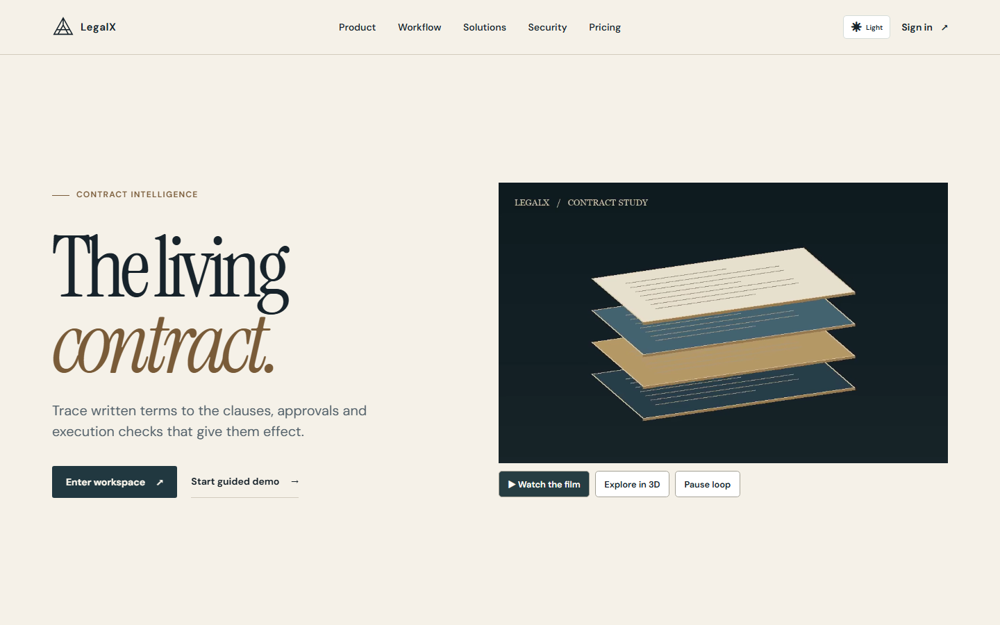

*The public story is presented on the homepage — including the canonical ₹30,000 vs ₹35,000 case. See [EVIDENCE.md](docs/screenshots/current/EVIDENCE.md) for the LIVE-BACKEND vs DEMO-SIMULATED classification of each capture.*

---

## The problem: legal language and executable logic drift apart

A signed agreement is written in prose. The parameters that would actually govern an executable representation live in a different form. Nothing forces the two to stay in agreement, and each can look correct on its own while the money does not reconcile between them. In a legal-tech context that gap is the whole risk: a deal can be *approved* and still not mean what was *encoded*.

---

## A five-thousand-rupee disagreement

The canonical case, shown on the public homepage, is a client agreeing to pay a developer **₹30,000** in **3 × ₹10,000** milestones, while the proposed executable specification encodes a total of **₹35,000**:

| Representation | Value |
| --- | --- |
| Agreed deal | ₹30,000 |
| Milestone schedule | 3 × ₹10,000 = ₹30,000 |
| Encoded agreement total | ₹35,000 |
| **Mismatch** | **₹5,000** |

Source: `src/components/ContractStory.tsx:5–10`. This story is deliberately distinct from the separate **₹50,000** demo-workflow constant; the two are never conflated. It is an illustrative, jury-facing example — not evidence of a live transaction.

---

## How LEGALX addresses it

1. **Derive a canonical Contract IR** from the natural-language terms, hash-bound with a canonical SHA-256.
2. **Check parity** between the readable agreement and the supported execution parameters using a real Python parity engine.
3. **Surface findings** — a critical mismatch (such as the ₹5,000 discrepancy) blocks the execution path.
4. **Gate execution** on approvals of the exact version hash, the approved party, draft state, a fresh hash, idempotency, and an audit event.
5. **Issue a Trust Passport** that is re-derived server-side: hashes, versions, engine version, and status as technical evidence only.

A clean parity result is still subject to the approval gate, an organization-scoped authorization check, and a human decision. Parity and hashing prove *consistency*, never *enforceability*.

---

## What LEGALX actually does

| Capability | Status | Boundary |
| --- | --- | --- |
| Public site, responsive layout, light/dark theme | **REAL** | Vite/React SPA; light is the default, dark is a persisted preference |
| Guest demo and canonical golden path | **REAL** | Rehearsed 30/30 pages across 5/5 roles |
| Sessions, argon2 hashing, cookie + CSRF, 5 roles | **REAL** | Server-computed permissions; local role switcher is demo-only |
| Agreements, versions, approvals, activity | **REAL** | 15 live HTTP routes under `/api` and `/api/v1` |
| Contract IR derivation + parity engine | **REAL** | Python libraries with ~85 unit tests |
| Parity verification + evidence-only Trust Passport | **REAL** | Server-re-derived; informational, not an execution credential |
| Off-chain execution gate | **REAL** | Approvals, party, state, fresh hash, idempotency, audit |
| Deterministic AI / seeded extraction | **SIMULATED** | Fixture-based; no AI-extraction HTTP route |
| Tamper demo and smart-contract / wallet screens | **SIMULATED** | Labelled demo fixtures; no transaction, wallet, or escrow |
| On-chain execution / Solidity deployment / real escrow | **OUT OF SCOPE** | Explicitly out of scope by decision and audit |
| Live hosted deployment | **PENDING** | Config valid; preview deploy blocked on a provided `DATABASE_URL` |
| MIT license | **PROPOSED** | Not granted — see [license status](#license-status) |

The authoritative HTTP surface is **15 real routes** — full contract in [docs/API.md](docs/API.md). There is **no** review, tamper, verify-on-legacy, execution-`prepare`, wallet, or on-chain endpoint.

<details>
<summary>The 15 real HTTP routes</summary>

| Method | Route |
| --- | --- |
| `GET` | `/api/health` |
| `POST`, `DELETE` | `/api/v1/auth/session` |
| `GET` | `/api/v1/me` |
| `GET`, `POST` | `/api/v1/agreements` |
| `GET`, `PATCH` | `/api/v1/agreements/{id}` |
| `GET`, `POST` | `/api/v1/agreements/{id}/versions` |
| `POST` | `/api/v1/agreements/{id}/versions/{n}/approve` |
| `GET` | `/api/v1/activity` |
| `POST` | `/api/v1/agreements/{id}/execution` |
| `POST` | `/api/v1/agreements/{id}/versions/{version}/verify` |
| `GET` | `/api/v1/agreements/{id}/trust-passport` |

</details>

---

## Screenshots

Repository captures, **not** claims of a live deployment. Each is classified LIVE-BACKEND or DEMO-SIMULATED in [EVIDENCE.md](docs/screenshots/current/EVIDENCE.md).

<table>
  <tr>
    <td align="center"><a href="docs/screenshots/current/dashboard.png">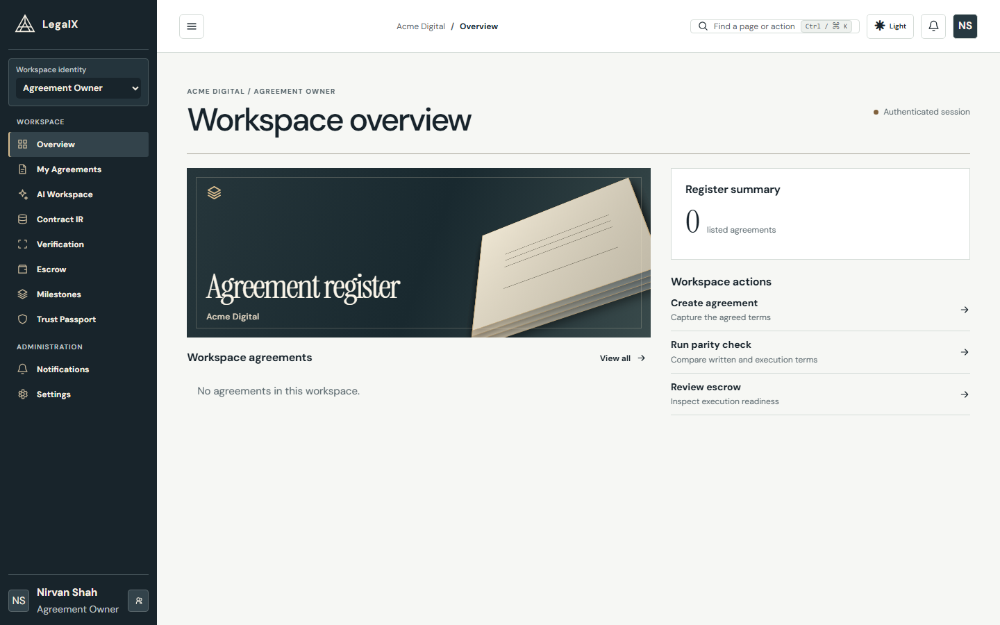</a><br><em>Dashboard — see EVIDENCE.md for classification.</em></td>
    <td align="center"><a href="docs/screenshots/current/agreements.png">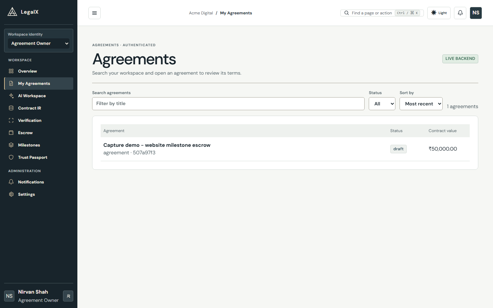</a><br><em>Agreements library — see EVIDENCE.md for classification.</em></td>
  </tr>
  <tr>
    <td align="center"><a href="docs/screenshots/current/agreement-intelligence.png">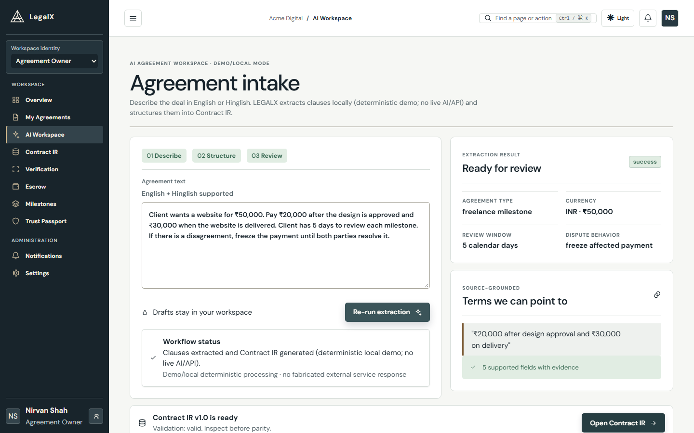</a><br><em>Agreement intelligence — simulated extraction shown as such.</em></td>
    <td align="center"><a href="docs/screenshots/current/contract-ir.png">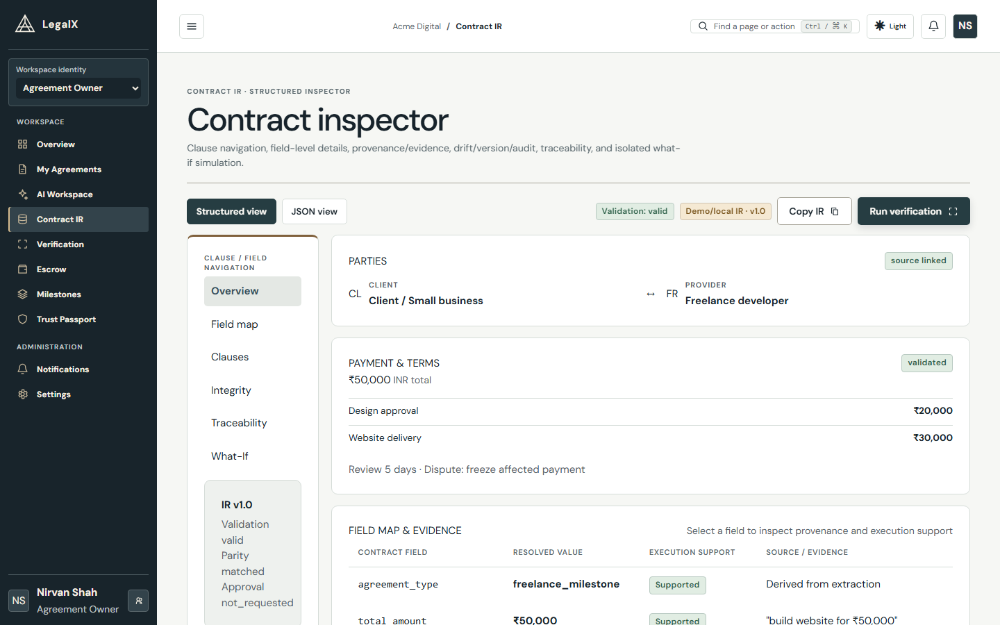</a><br><em>Canonical Contract IR view — see EVIDENCE.md for classification.</em></td>
  </tr>
  <tr>
    <td align="center"><a href="docs/screenshots/current/parity.png">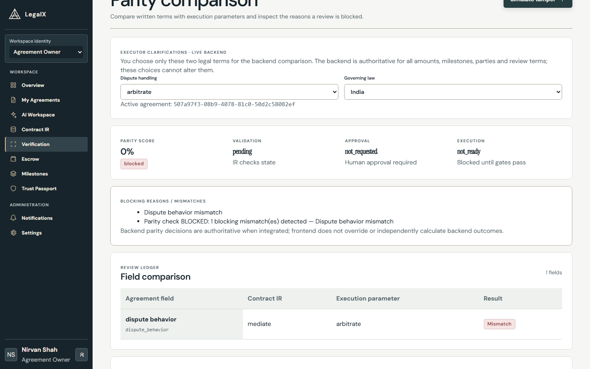</a><br><em>Parity comparison — see EVIDENCE.md for live-vs-demo classification.</em></td>
    <td align="center"><a href="docs/screenshots/current/trust-passport.png">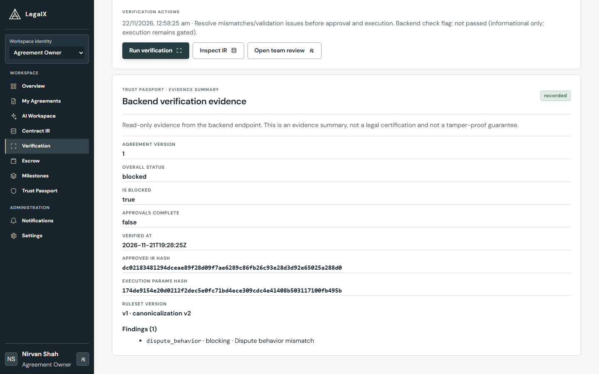</a><br><em>Evidence-only Trust Passport — see EVIDENCE.md for classification.</em></td>
  </tr>
  <tr>
    <td align="center"><a href="docs/screenshots/current/execution-gate.png">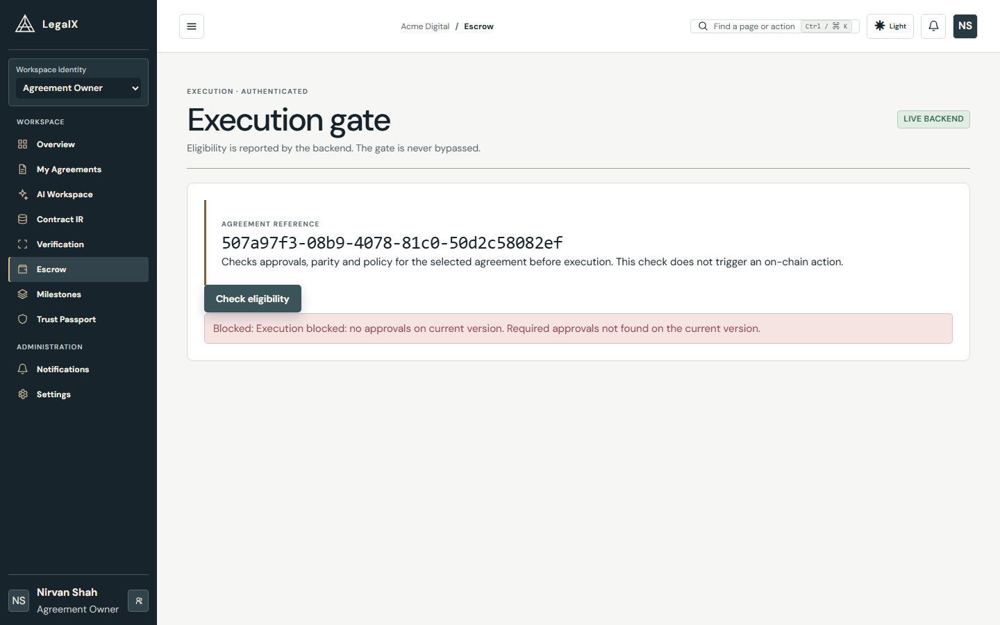</a><br><em>Off-chain execution gate — see EVIDENCE.md for classification.</em></td>
    <td align="center"><a href="docs/screenshots/current/dark-mode.png">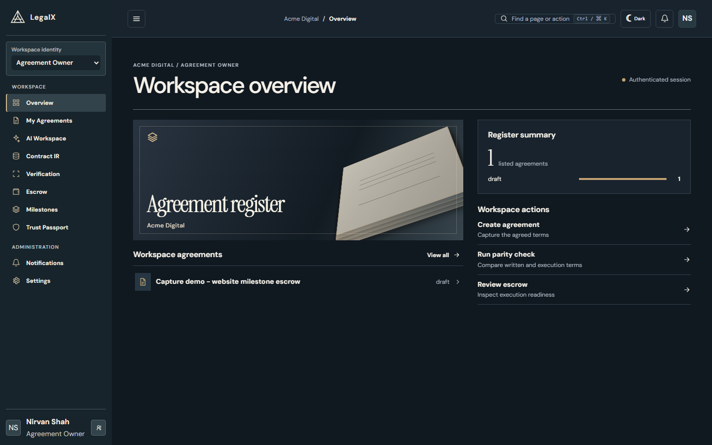</a><br><em>Dark theme (persisted preference; light is the default).</em></td>
  </tr>
  <tr>
    <td align="center"><a href="docs/screenshots/current/mobile.png">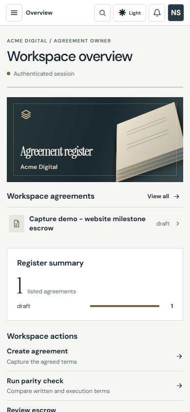</a><br><em>Responsive mobile layout — see EVIDENCE.md for classification.</em></td>
    <td align="center">&nbsp;</td>
  </tr>
</table>

---

## Product film

A real 63-second product film and an 8-second companion clip exist in the repository as files (`public/film/legalx.mp4`, `public/film/living-contract.mp4`) with a poster (`poster.jpg`), an English caption track (`legalx.en.vtt`, 17 cues), and `.srt`/`.vtt` tracks. GitHub cannot render an inline cinematic player, so the poster links directly to the film file:

[](public/film/legalx.mp4)

*Click the poster to open the film file. A hosted film-page link will be placed here once a preview deployment exists ([live demo](#live-demo)). Media provenance and licensing are **UNVERIFIED** — no rights are claimed; see [docs/MEDIA_PROVENANCE.md](docs/MEDIA_PROVENANCE.md). Nothing here is screen-recorded proof of a live deployment or a real blockchain transaction.*

---

## Interactive 3D experience

The public experience uses a Three.js hero sculpture (`src/components/Sculpture.tsx`, `three` ^0.187.0) within the **Astra Noir** layered art direction — a visual treatment, backed by a separately bundled chunk, not a legal-analysis feature. Motion is restrained and respects reduced-motion preferences; users advance the story manually. Light is the default theme and dark is a persisted preference. See [Astra Noir verification](docs/ASTRA_NOIR_VERIFICATION.md).

No official logo **image** asset exists: the identity is an inline SVG mark plus a text wordmark. The header above is a typographic wordmark, not an implied logo file.

---

## System architecture

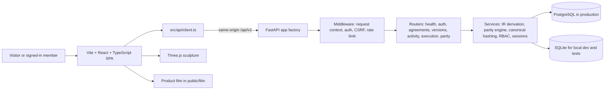

Client-supplied roles, user IDs, and workspace IDs are never trusted; protected routes re-check authentication and authorization. See [docs/ARCHITECTURE.md](docs/ARCHITECTURE.md) and [docs/API.md](docs/API.md).

---

## Workflows

**Intake → review → Contract IR**

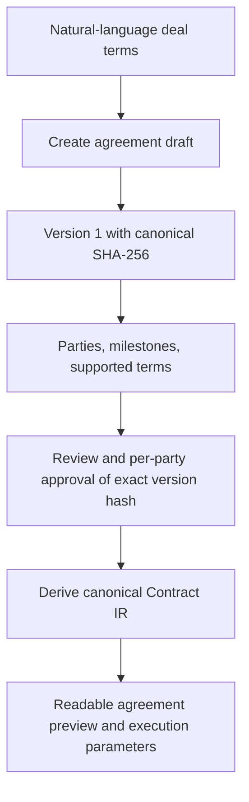

**Parity → findings → Trust Passport**

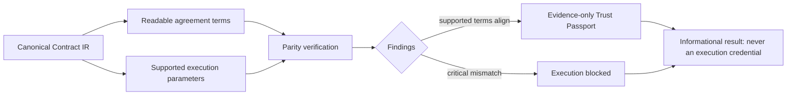

**Approval → off-chain execution gate**


---

## Contract IR and Parity Engine

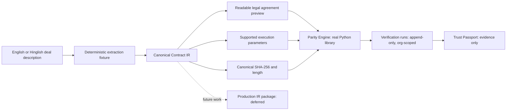

The parity engine and IR derivation are **real Python libraries** with roughly **85 unit tests**. The live verification endpoint takes a strict two-field payload (`dispute_behavior`, `governing_law`) with `extra="forbid"`; results are re-derived server-side. Extraction into IR is a deterministic fixture today — there is no Gemini provider connected and no AI-extraction HTTP route.

---

## Trust Passport and execution safeguards

The Trust Passport is **evidence-only**: hashes, versions, engine version, and status, recomputed by the server rather than trusted from the client. It is not a legal opinion and not an on-chain fact.

Execution is a separate technical control. It requires approvals on the current version, the approved party, draft state, a **fresh SHA-256**, idempotency, and an audit event; concurrency is handled with a conditional update. A parity result of `passed` is informational — it **never** grants execution. Identity binding (e.g., a swapped counterparty) is advisory-only and deferred. See [docs/SECURITY.md](docs/SECURITY.md), [docs/TRUST_LAYER.md](docs/TRUST_LAYER.md), and [docs/INTEGRITY_AND_HASHING.md](docs/INTEGRITY_AND_HASHING.md).

---

## Supported user journeys

One application shell serves five permission-aware identities:

| Role | Typical journey |
| --- | --- |
| `owner` | Create and fund agreements, approve milestones |
| `freelancer` | View assigned work and permitted payments |
| `legal_reviewer` | Review clauses, comments, and legal approval |
| `org_admin` | Manage members, roles, integrations, and logs |
| `technical_auditor` | Read-only Contract IR, parity, and hashes |

The active identity changes dashboard metrics, navigation, permitted actions, and protected-route behavior; unauthorized mounts show a 403-style state. The role switcher is a **local demo-only** control — production identity binding is advisory/deferred, not implemented. A guest golden path is available at `/demo`. See [docs/RBAC.md](docs/RBAC.md) and [docs/DEMO_GUIDE.md](docs/DEMO_GUIDE.md).

---

## Technology stack

| Layer | Technology |
| --- | --- |
| Frontend | React + TypeScript + Vite 8 |
| Backend | FastAPI + SQLAlchemy 2 + Alembic (Python 3.11) |
| Database | PostgreSQL (production target via Vercel); SQLite for local dev and tests |
| Security | argon2 password hashing, cookie + CSRF sessions, 5 roles, server-side RBAC |
| Parity / IR | Real Python libraries (~85 unit tests) |
| 3D | Three.js ^0.187.0 (`src/components/Sculpture.tsx`) |
| Tests | pytest, Playwright, Node workflow/rehearsal scripts |

Deployment is configured with two Vercel services: `app` (Vite frontend, root `.`, public route `/`) and `api` (FastAPI, root `.` — a documented deviation from an `api` root because of 140 absolute imports — public route `/api`). Rewrites map `/api/(.*)` → `api` and `/(.*)` → `app`. See [docs/VERCEL_DEPLOYMENT.md](docs/VERCEL_DEPLOYMENT.md).

---

## Live demo

> **No live hosted demo is available yet.** The Vercel project is `lexora-legalx` (not the older `legalx`). Its configuration is structurally valid, but the preview deploy is **pending owner provisioning of `DATABASE_URL`** (Neon free tier).
>
> **Live demo URL:** _pending deployment — no URL to publish at this time._

A URL will be placed here only after a successful preview deploy. No hosted film page or demo URL is asserted elsewhere in this README.

---

## Developer setup

```bash
npm install
npm run dev                 # Vite dev server on port 3000
npx tsc --noEmit
npm test
npm run build
npm run rehearse:judge
```

Backend (Python 3.11, from the repository root using the project virtual environment; dependencies in `api/requirements.txt`, migrations via `alembic.ini`):

```bash
.venv\Scripts\python.exe -m pytest api/tests -q --no-header
```

Playwright parity E2E:

```bash
npx playwright test --config playwright.parity.config.ts --workers=1
```

Full instructions: [docs/SETUP.md](docs/SETUP.md), [docs/TESTING.md](docs/TESTING.md), [docs/DEPLOYMENT.md](docs/DEPLOYMENT.md).

---

## Environment configuration

Environment variable **names only** — never commit values. No secret is required for the guest demo; none of these integrations is claimed as active.

| Scope | Variable names |
| --- | --- |
| Backend / runtime | `APP_ENV`, `DATABASE_URL`, `CORS_ORIGINS`, `DEMO_TAMPER_ENDPOINT`, `LOG_LEVEL`, `SESSION_TTL_HOURS`, `SESSION_ABSOLUTE_DAYS`, `FEATURE_AI_EXTRACTION`, `LOGIN_RATE_LIMIT_ATTEMPTS`, `LOGIN_RATE_LIMIT_WINDOW_SECONDS` |
| AI (server-side) | `GEMINI_API_KEY`, `LEGALX_GEMINI_MODEL` |
| Frontend | `VITE_API_BASE_URL` |

---

## Tests and evidence

Authoritative verification, with captured output at merge commit `629a07c`:

| Check | Result |
| --- | --- |
| Backend pytest | **447 passed / 3 skipped / 1 warning**, exit 0 |
| TypeScript (`npx tsc --noEmit`) | exit 0 |
| Frontend `npm test` | **9/9** chained scripts, exit 0 |
| Production Vite build | exit 0; pre-existing >500 kB chunk advisory, not a regression |
| Parity Playwright E2E | **10 passed / 0 failed / 0 skipped** |
| Judge rehearsal | **PASS** — 30/30 pages, 5/5 roles |
| QA gate | **PASS WITH MINOR FINDINGS** |
| Independent reviewer gate | **PASS WITH MINOR FINDINGS** |

The parity engine and IR derivation have roughly 85 unit tests within the backend suite. See [Phase 10 — Testing](docs/final-delivery/PHASE_10_TESTING.md) and the [Final Master Report](docs/final-delivery/FINAL_MASTER_REPORT.md).

<details>
<summary>Final delivery phase reports</summary>

- [Phase 07 — Engineering](docs/final-delivery/PHASE_07_ENGINEERING.md)
- [Phase 08 — Backend API](docs/final-delivery/PHASE_08_BACKEND_API.md)
- [Phase 09 — Frontend](docs/final-delivery/PHASE_09_FRONTEND.md)
- [Phase 10 — Testing](docs/final-delivery/PHASE_10_TESTING.md)
- [Phase 11 — Deployment](docs/final-delivery/PHASE_11_DEPLOYMENT.md)
- [Phase 12 — Hackathon](docs/final-delivery/PHASE_12_HACKATHON.md)

</details>

---

## Security and simulation boundaries

- **Real controls:** argon2 password hashing, cookie + CSRF sessions, server-computed permissions, organization-scoped authorization, version-hash-bound approvals, a conditional-update execution gate, append-only audit events, and idempotency.
- **Informational only:** parity `passed`; it never grants execution.
- **Advisory / deferred:** identity binding such as a swapped counterparty.
- **Known limitation:** the per-instance in-memory rate limiter is not shared across processes (owner-accepted and documented).
- **Out of scope:** no Solidity deployment, on-chain transactions, wallets, or real escrow — frozen at simulation by decision and audit. No secrets are in the repository.
- **No claims made:** no professional security audit, WCAG conformance, or legal-enforceability guarantee.

See [docs/SECURITY.md](docs/SECURITY.md), [docs/OMEGA_FRS.md](docs/OMEGA_FRS.md), and the [blockchain audit](docs/audit/BLOCKCHAIN_AUDIT.md).

---

## Project structure

```text
.
├── api/                 FastAPI backend (app/, routers/, parity/, models/, tests/, requirements.txt)
├── src/                 React + TypeScript frontend (components/, api/, styles/)
├── docs/                PRD, API, SECURITY, OMEGA_FRS, final-delivery/, screenshots/current/
├── e2e/                 Playwright end-to-end specs
├── scripts/             Test and demo-rehearsal scripts
├── public/              film/, fonts/, noir/
├── alembic.ini          Database migrations
├── vercel.json          Two-service Vercel configuration
├── vite.config.ts       Frontend build configuration
├── playwright*.config.ts Playwright configurations
└── README.md
```

---

## Team and contributions

Contributions are governed by [CONTRIBUTING.md](CONTRIBUTING.md). Authorship is recorded in repository history; no individual contributor names are asserted in this README. The work is tracked through the [final delivery reports](docs/final-delivery/FINAL_MASTER_REPORT.md) and the [OMEGA functional requirements](docs/OMEGA_FRS.md).

---

## License status

**No license is currently granted.** `docs/proposed-LICENSE.md` is an **MIT proposal only**, not an active license. [LICENSING_REVIEW.md](docs/LICENSING_REVIEW.md) records status **BLOCKED** pending owner/contributor consent, media provenance resolution, and an SIL OFL 1.1 carve-out.

- Film and noir artwork provenance/licensing is **UNVERIFIED** — no rights are claimed. See [docs/MEDIA_PROVENANCE.md](docs/MEDIA_PROVENANCE.md).
- The bundled fonts, **DM Sans** and **Instrument Serif**, are licensed under **SIL OFL 1.1** (notices present) and are **excluded** from any MIT claim.
- No logo image is asserted; the identity is a typographic wordmark and inline SVG mark.

---

## Hackathon context

LEGALX was built for **HackIndia 2026** under problem statement **PS-03** by **LEXORA** (participant ID **HI025038**). The prototype is intentionally honest about its boundary: the Contract IR derivation, parity engine, HTTP surface, session/RBAC controls, and execution gate are real and verified; AI extraction, tamper demos, and smart-contract/wallet screens are labelled simulations; on-chain execution and real escrow are out of scope. See [Phase 12 — Hackathon](docs/final-delivery/PHASE_12_HACKATHON.md), the [product roadmap](docs/PRODUCT_ROADMAP.md), and the [decision records](docs/DECISIONS.md).

---

**Verify the agreement. Then execute.**
