# LEGALX - Work In Progress

### From human agreements to executable trust.

> **Honesty boundary.** LEGALX verifies *consistency between representations*. It does not guarantee legal correctness, enforceability, or liability outcomes. Where authentication, AI, storage, wallet, or blockchain services are not actually connected, the interface says so explicitly. See the [feature matrix](#verified--simulated--deferred) and the [final delivery report](docs/final-delivery/FINAL_MASTER_REPORT.md).

---

## The problem: a five-thousand-rupee disagreement

A freelancer and a client agree on **₹30,000**, payable as **3 × ₹10,000** milestones. The contract that gets signed encodes a total of **₹35,000**. Both documents read like the same deal, but the money does not reconcile:

| Representation | Value |
| --- | --- |
| Agreed deal (public story) | ₹30,000 |
| Milestone schedule | 3 × ₹10,000 = ₹30,000 |
| Encoded agreement total | ₹35,000 |
| **Mismatch** | **₹5,000** |

The canonical demo data for this story lives in `src/components/ContractStory.tsx:5–9`. It is deliberately distinct from the ₹50,000 website-agreement constant used in the in-app workflow; the two were not conflated.

## The solution

LEGALX turns a plain-language deal into a structured, hash-bound representation, then checks whether the agreement text and the supported execution parameters still say the same thing. A critical mismatch **blocks** the execution path; a clean match is still subject to an approval gate, an organization-scoped authorization check, and a human decision. Trust evidence (hashes, versions, engine version, status) is re-derived server-side — it is technical evidence, not legal advice and not an on-chain fact.

The boundary is deliberate: parity and hashing prove *consistency*, never *enforceability*.

---

## Product film

The repository contains a real product film and its assets. The media is untracked and its licensing is **UNVERIFIED** — see [media provenance](docs/MEDIA_PROVENANCE.md). Nothing here is screen-recorded proof of a live deployment or a real blockchain transaction.

[Watch the LEGALX product film (MP4)](public/film/legalx.mp4) · [Poster image](public/film/poster.jpg) · [Captions (`legalx.vtt`)](public/film/legalx.vtt) · [English captions (`legalx.en.vtt`)](public/film/legalx.en.vtt)

<video controls preload="metadata" width="720">
  <source src="public/film/legalx.mp4" type="video/mp4" />
  <track kind="captions" src="public/film/legalx.vtt" srclang="en" label="English" />
  <track kind="captions" src="public/film/legalx.en.vtt" srclang="en" label="English (dedicated)" />
  Your browser does not support HTML video. Use the direct MP4 link above.
</video>

---

## VERIFIED / SIMULATED / DEFERRED

**VERIFIED** = implemented in code with recorded verification evidence. **SIMULATED** = clearly labelled deterministic demo fixture, not a live external service. **DEFERRED** = not implemented in this scope. Evidence below reflects authoritative **M5 verification** (see `docs/final-delivery/PHASE_10_TESTING.md`); checks were executed with captured output in M5.

| Capability | Status | Basis / boundary |
| --- | --- | --- |
| Public marketing site, responsive layout, light/dark theme, reduced motion | **VERIFIED** | Vite/React SPA; light is the default (`index.html`, `src/main.tsx`); rendering evidence in `docs/PHASE7_CLOSEOUT_REPORT.md` §9 |
| Guest demo at `/demo` and canonical golden path | **VERIFIED** | M5 rehearse:judge PASS 30/30 pages, 5/5 roles in 53.747 s; demo 3/3 personas |
| Three.js hero sculpture | **VERIFIED** | `src/components/Sculpture.tsx` imports `three`; bundled as its own chunk at build |
| Session sign-in/out, `lx_session` cookie, CSRF header, server-computed permissions | **VERIFIED** | `api/app/routers/auth.py`; `docs/RBAC.md`; negative tests in `scripts/test-rbac.mjs` |
| Role-aware workspaces (5 roles), protected routes, 403 states | **VERIFIED** (UI) | Local role switcher is a **demo-only** control; production identity binding is not implemented |
| Agreement create/list/get/patch, versions, approvals, milestones, activity | **VERIFIED** | 15 real HTTP routes; `docs/API.md`; M5 pytest 447 passed / 3 skipped / 1 warning |
| Canonical hashing, version integrity, append-only verification runs | **VERIFIED** | `api/app/parity/`, `api/app/models/verification.py`; legal-gate files byte-identical at M5 (engine.py `85E4D3EE…ACC2`, comparison_rules.py `C0FDBF4A…DE434`, schemas/parity.py `DCFE9E1E…98B525`) |
| Parity verification HTTP surface + evidence-only Trust Passport | **VERIFIED** | `POST .../verify`, `GET .../trust-passport`; strict 2-field payload `{dispute_behavior, governing_law}` with `extra="forbid"`; M5 parity E2E 10 passed / 0 failed / 0 skipped in 1.7m |
| Execution gate (approvals, party, state, idempotency, 409/403/429) | **VERIFIED** | `api/app/routers/execution.py`; conditional `UPDATE` for concurrency; E2E confirms the gate still returns 403 |
| Deterministic AI / seeded extraction and source-grounded clauses | **SIMULATED** | Fixture-based; no Gemini provider is connected and no AI-extraction HTTP route exists |
| Tamper demo (review window 5 → 2 days; score 74; execution blocked; restore → 100) | **SIMULATED** | Deterministic demo fixture. The live path derives its result from the backend and never hardcodes a score |
| Smart-contract / Sepolia workspace, milestones and transactions | **SIMULATED** | UI records only; no transaction submission, no private-key handling, no on-chain scope |
| Supabase Auth / Database / Storage, server-side Gemini validation | **DEFERRED** | `docs/PRODUCT_ROADMAP.md` "Next" / "Later" |
| Wallet lifecycle, on-chain event indexing, real escrow | **DEFERRED** | Out of scope by owner decision and repo truth (`docs/DECISIONS.md`, `docs/STATE.md`) |
| Production Contract IR package / private document upload / Trust Passport export | **DEFERRED** | UI schema representation today; production integration pending |
| Live Vercel deployment with persistent Postgres | **DEFERRED / BLOCKED** | Scaffolding only; no live deploy; live DB deploy blocked pending an owner-provided `DATABASE_URL` |
| MIT license assertion | **DEFERRED / BLOCKED** | Proposal only; no active license asserted. See [licensing review](docs/LICENSING_REVIEW.md) |

> The per-instance in-memory rate limiter is a known, owner-accepted limitation: it is not shared across processes. See [security](docs/SECURITY.md) and `docs/OMEGA_FRS.md` §8d.

---

## Judge walkthrough

1. Open `/demo` or choose **Explore live demo** from the landing page.
2. Choose **AI Workspace** and review the seeded agreement; note the deterministic (simulated) extraction.
3. Open **Contract IR** to inspect the structured source of truth and its JSON representation.
4. Open **Parity Verification**, choose **Simulate tamper**, and observe the blocking mismatch.
5. Choose **Restore matching logic**, then visit Smart Contracts, Milestones, Transactions, and Activity. Smart-contract records are visibly simulated.
6. Open the project agreement detail for the lifecycle, document preview, version, and integrity-hash evidence.

Full script: [demo guide](docs/DEMO_GUIDE.md). Machine-readable record: [latest rehearsal](docs/rehearsals/latest.json).

---

## Architecture

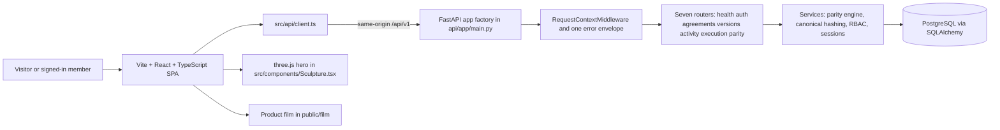

Client-supplied roles, user IDs, and workspace IDs are never trusted; every protected route re-checks authentication and authorization. See [architecture](docs/ARCHITECTURE.md) and [API and validation](docs/API.md).

### Agreement workflow

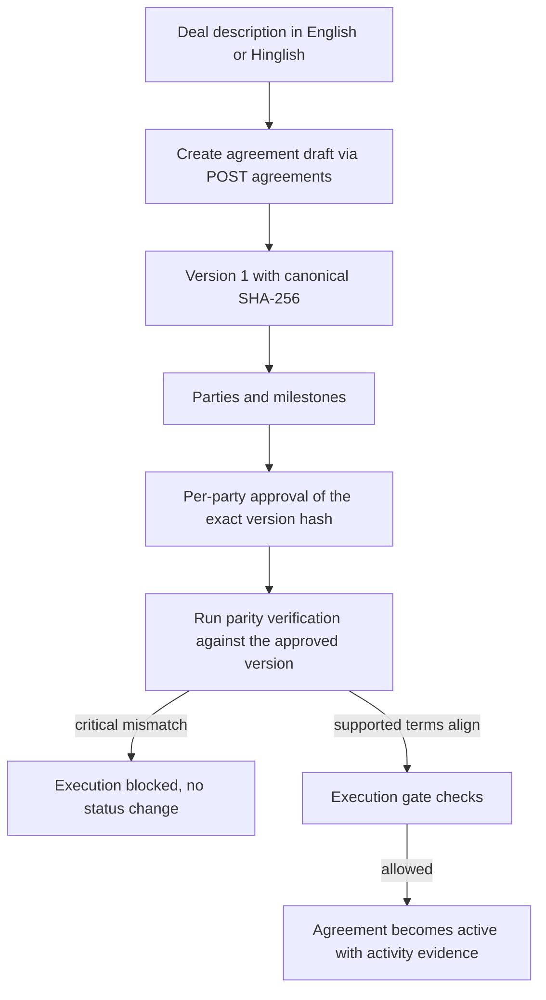

### Contract IR flow

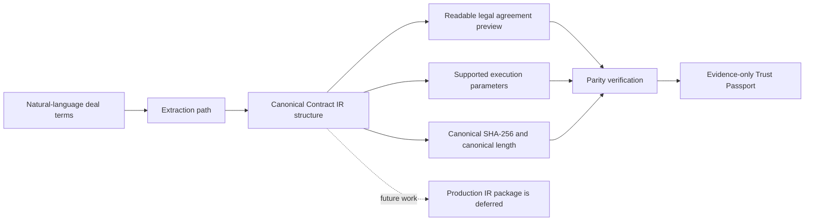

The extraction path is a deterministic fixture today; there is no AI-extraction HTTP endpoint. The Trust Passport is re-derived server-side and is not a client-trusted source.

### Execution gate

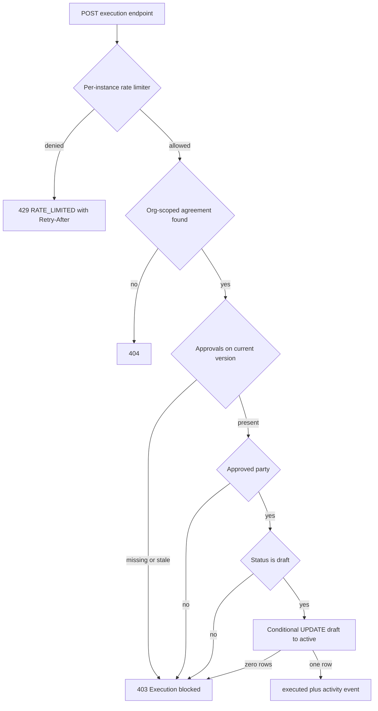

The gate is a technical control, not a legal one. Legal-gate files were byte-identical at Phase 7 closeout; see `docs/PHASE7_CLOSEOUT_REPORT.md` §7.

### Database schema

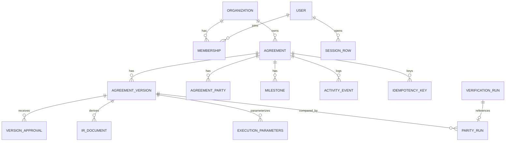

Entity names follow `api/app/models/`. Verification runs are append-only and organization-scoped. See [database and persistence](docs/DATABASE.md).

### Demo golden path

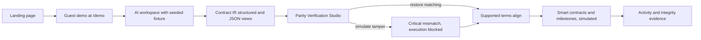

---

## Getting started: verified commands

The app is a Vite + React + TypeScript frontend plus a FastAPI Python backend. `public/manus-routes.json` declares every page route for the managed runtime. The default theme is **light**; dark is a persisted user preference toggled at runtime — the repository is **not dark-only** (`index.html:9–22`, `src/main.tsx:8–9`).

```bash
npm install
npm run dev
npx tsc --noEmit
npm test
npm run test:e2e -- e2e/parity.spec.ts --config playwright.parity.config.ts
npm run build
npm run rehearse:judge
```

Backend (from the repository root, using the project virtual environment):

```bash
.venv\Scripts\python.exe -m pytest api/tests -q --no-header
```

Authoritative M5 verification results (captured output; exit 0 each):

| Check | M5 result |
| --- | --- |
| Backend pytest | 447 passed / 3 skipped / 1 warning in 91.04 s, exit 0 |
| TypeScript (`npx tsc --noEmit -p tsconfig.json`) | exit 0 |
| Frontend `npm test` | 9/9 chained scripts, exit 0 |
| `npm run build` | exit 0; Vite v8.3.6, 40 modules, 1.47 s; `index-B6Q4ziVK.js` 479.17 kB + `Sculpture-CUOBJndu.js` 539.45 kB; >500 kB advisory pre-existing, not a regression |
| Parity E2E (`npx playwright test --config playwright.parity.config.ts --workers=1`) | 10 passed / 0 failed / 0 skipped in 1.7m, exit 0 |
| `npm run rehearse:judge` | PASS, pages=30/30, roles=5/5, 53.747 s, exit 0; `rehearse:demo` 3/3 personas |

> R7 Git delivery remains **Pending**; formal QA sign-off remains Pending per owner decision (see `docs/final-delivery/FINAL_MASTER_REPORT.md`).

### Stack

- **Frontend:** Vite, React, TypeScript, React DOM (`package.json`).
- **3D:** `three` (`^0.187.0`) with the hero sculpture in `src/components/Sculpture.tsx`.
- **Styling:** modular CSS under `src/styles/` — `styles.css`, `theme.css`, `design.css`, `landing.css`, `astra-layout.css`, `controls.css`, `walkthrough.css` — imported from `src/main.tsx`. There is no top-level `src/styles.css`.
- **Backend:** FastAPI, SQLAlchemy, Alembic; PostgreSQL in production mode, SQLite for local development.
- **Testing:** Playwright, Node demo/RBAC/workflow scripts, pytest.
- **Docs:** [setup](docs/SETUP.md), [operations](docs/OPERATIONS.md), [testing](docs/TESTING.md).

### Environment and integrations

Real deployment configuration uses environment **names only** — never commit values: `APP_ENV`, `DATABASE_URL`, `CORS_ORIGINS`, `DEMO_TAMPER_ENDPOINT`, `LOG_LEVEL`, `SESSION_TTL_HOURS`, `SESSION_ABSOLUTE_DAYS`, `FEATURE_AI_EXTRACTION`, `LOGIN_RATE_LIMIT_ATTEMPTS`, `LOGIN_RATE_LIMIT_WINDOW_SECONDS`, `GEMINI_API_KEY`, `LEGALX_GEMINI_MODEL`, and frontend `VITE_API_BASE_URL`. No secret is needed for the guest demo. None of those integrations is claimed as active. See [deployment](docs/DEPLOYMENT.md).

---

## Documentation

- [Architecture](docs/ARCHITECTURE.md)
- [Setup](docs/SETUP.md)
- [Database and persistence](docs/DATABASE.md)
- [API and validation](docs/API.md)
- [AI pipeline](docs/AI_PIPELINE.md)
- [Blockchain](docs/BLOCKCHAIN.md)
- [Security](docs/SECURITY.md)
- [Testing](docs/TESTING.md)
- [Demo guide](docs/DEMO_GUIDE.md)
- [Deployment](docs/DEPLOYMENT.md)
- [Trust layer](docs/TRUST_LAYER.md)
- [Threat model](docs/THREAT_MODEL.md)
- [Integrity and hashing](docs/INTEGRITY_AND_HASHING.md)
- [Accessibility](docs/ACCESSIBILITY.md)
- [Performance](docs/PERFORMANCE.md)
- [Operations](docs/OPERATIONS.md)
- [Product roadmap](docs/PRODUCT_ROADMAP.md)
- [RBAC and workspace authorization](docs/RBAC.md)
- [Final acceptance audit](docs/FINAL_ACCEPTANCE_AUDIT.md)
- [Guided demo rehearsal record](docs/rehearsals/latest.json)
- [Product requirements](docs/PRD.md)
- [OMEGA functional requirements](docs/OMEGA_FRS.md)
- [Decision records](docs/DECISIONS.md)
- [Phase 7 closeout report](docs/PHASE7_CLOSEOUT_REPORT.md)
- [Final delivery master report](docs/final-delivery/FINAL_MASTER_REPORT.md)
- [Media provenance](docs/MEDIA_PROVENANCE.md)
- [Licensing review](docs/LICENSING_REVIEW.md)
- [Proposed LICENSE text](docs/proposed-LICENSE.md)
- [Contributing](CONTRIBUTING.md)

## Visual proof

Repository screenshots, not claims of a live deployment.

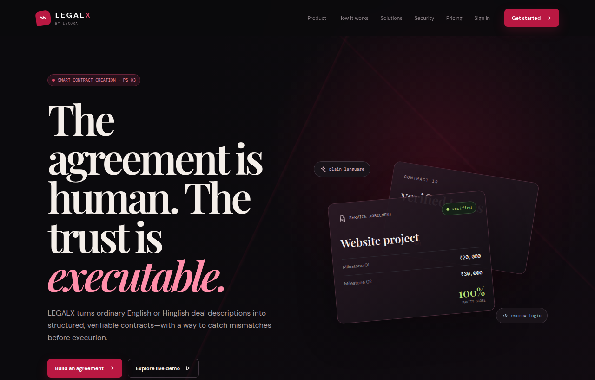

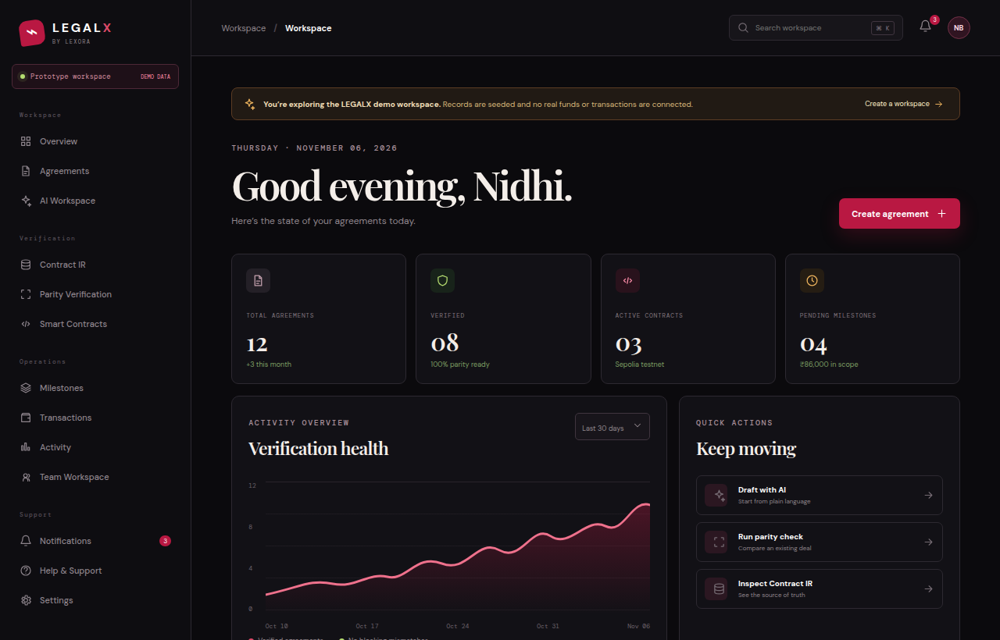

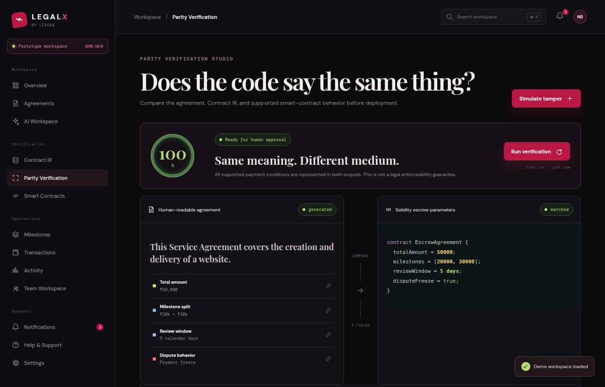

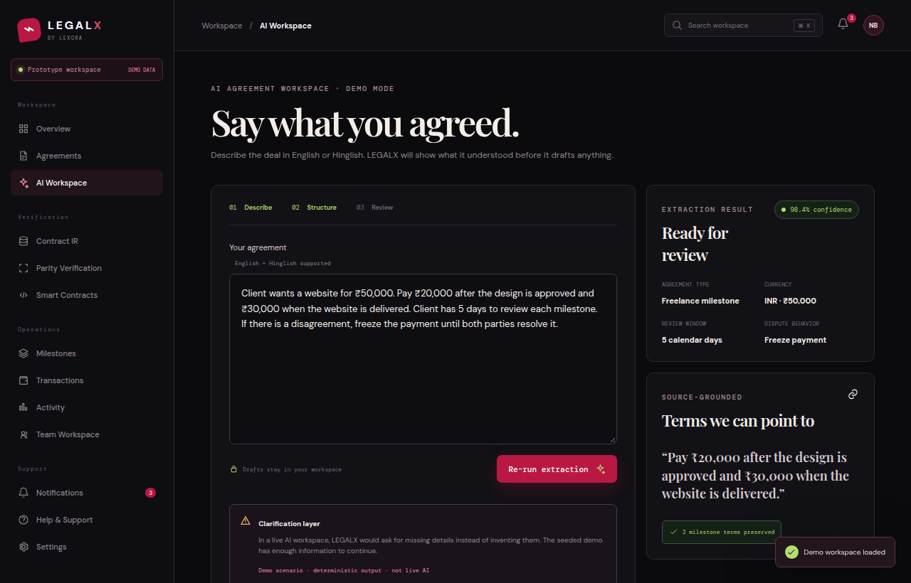

### Interaction proof

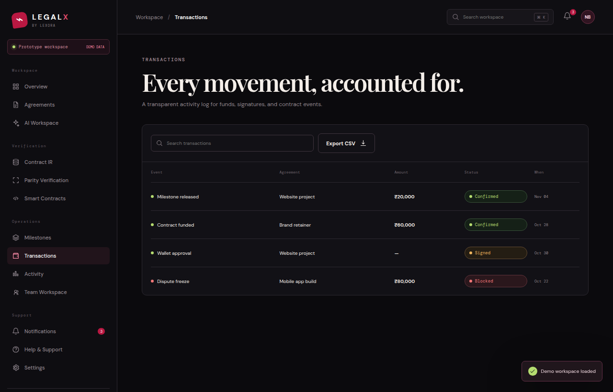

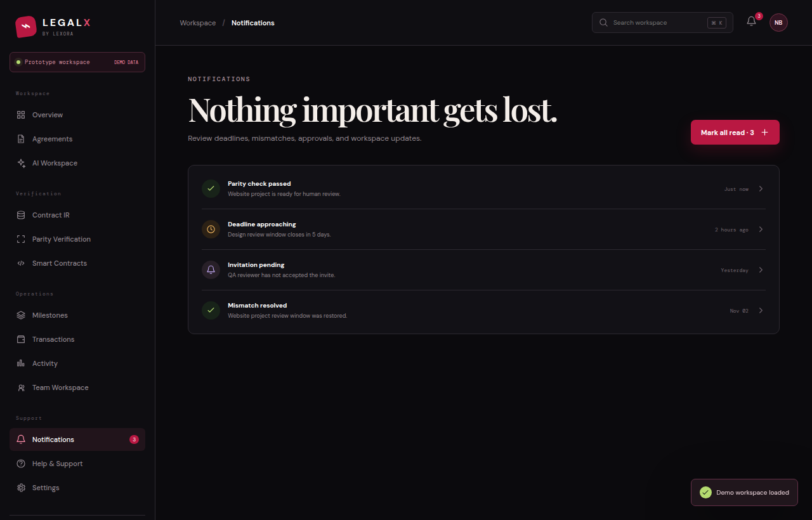

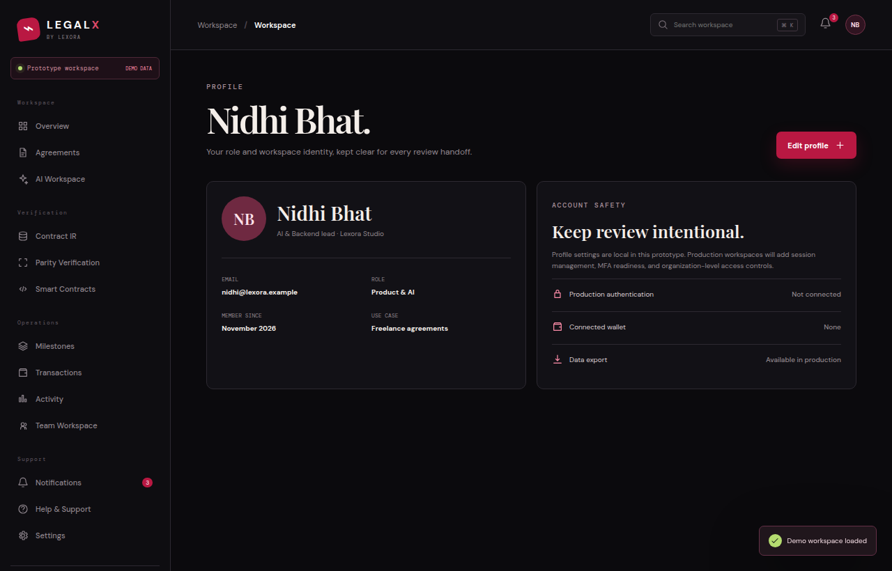

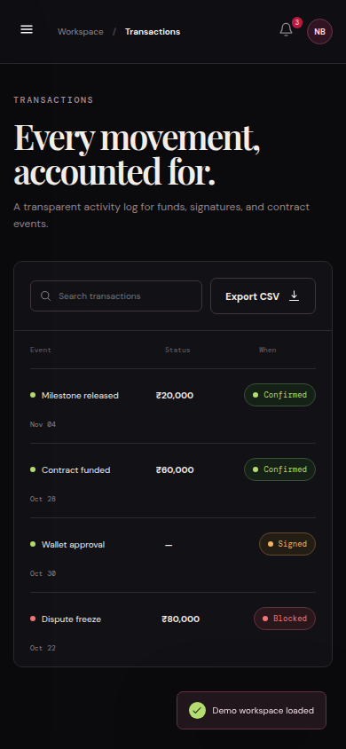

---

## Role-aware workspaces and access control

LEGALX uses one application shell with five permission-aware identities: Agreement Owner, Freelancer / Contractor, Legal Reviewer, Organization Admin, and Technical Auditor. The active identity changes dashboard metrics, sidebar navigation, permitted actions, financial visibility, and protected-route behavior. The demo role switcher is local-only and labelled as such; it is for judging the connected workflow, not a substitute for production authentication. Every protected route is checked through a centralized policy before its component mounts; unauthorized attempts show a 403-style state. Server-side helpers are in `server/authorization.ts` and `api/app/rbac.py`, with negative tests in `scripts/test-rbac.mjs`. See [RBAC](docs/RBAC.md) and [API](docs/API.md).

### Role-aware access flow

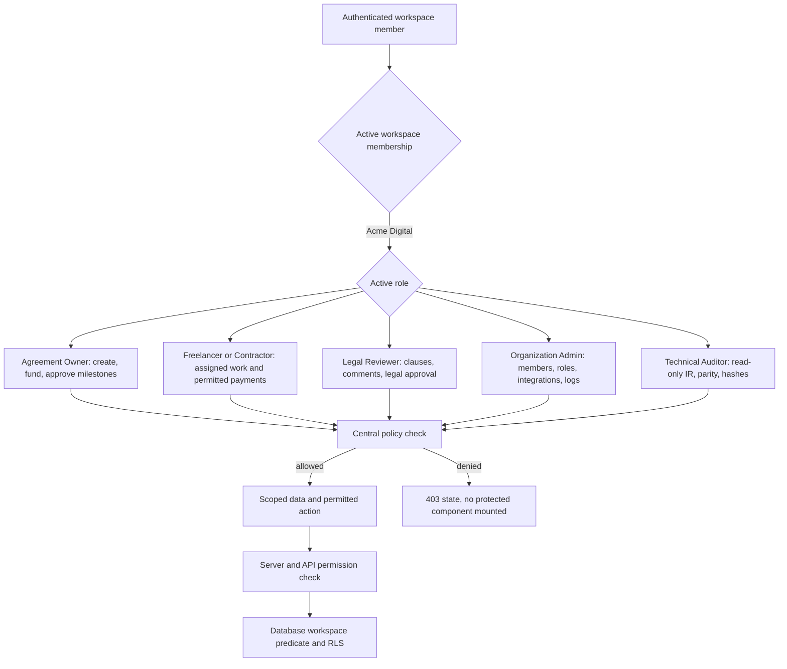

---

## Licensing and contributors

**No license is asserted.** A proposed MIT text with placeholder holder/year is recorded in [proposed LICENSE](docs/proposed-LICENSE.md), with blockers in [licensing review](docs/LICENSING_REVIEW.md). Film and noir artwork provenance is UNVERIFIED; bundled fonts carry SIL OFL 1.1 notices with a required carve-out, preserved in `public/fonts/`. See [media provenance](docs/MEDIA_PROVENANCE.md).

Contributions are governed by [CONTRIBUTING](CONTRIBUTING.md). No individual contributor names are asserted here; authorship is recorded in repository history.

## Known limitations

- No blockchain, MetaMask, wallet, or real escrow implementation; no transaction is claimed.
- No live Gemini provider and no AI-extraction HTTP route; extraction is a deterministic fixture.
- Trust Passport UI is read-only evidence, not a client-trusted source.
- Frontend role switching is a local demo construct.
- Pre-existing >500 kB bundle advisory; not remediated here.
- Per-instance in-memory rate limiting is not distributed across processes (owner-accepted, documented).
- No professional security audit, WCAG conformance claim, or legal enforceability claim is made.

---

Verify the agreement. Then execute.
