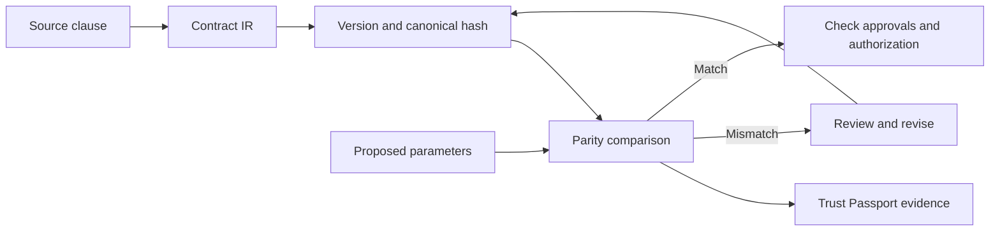
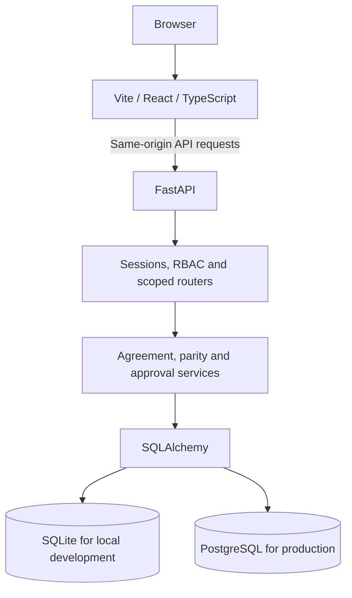

# LEGALX

**Verify the agreement before execution.**

Team LEXORA · HackIndia 2026

A client agrees to three ₹10,000 milestones. The written deal totals ₹30,000, but the proposed execution specification encodes ₹35,000. LegalX shows the reviewer the ₹5,000 difference and the field that needs attention. This is the jury walkthrough. The workspace uses a separate ₹50,000 website agreement for extraction and review.

[Run locally](#run-locally) · [API reference](docs/API.md) · [Judge walkthrough](docs/DEMO_GUIDE.md) · [Architecture](docs/ARCHITECTURE.md)

## From a clause to an execution decision

A reviewer needs to know which wording supports a payment, which version a party approved, and whether the execution parameters still match that version. LegalX ties these questions to a versioned record.

| Stage | What a reviewer can inspect |
| --- | --- |
| **Contract IR** | A structured intermediate representation of parties, amounts, milestones, review windows and dispute terms. Source references connect fields to clauses. The guest intake uses deterministic local extraction. |
| **Parity Engine** | The authenticated API compares the supported parameters for a specific version and records a verification run. The live request accepts dispute behavior and governing law. The illustrated financial mismatch and local tamper rehearsal are separate demonstrations. |
| **Trust Passport** | A read-only account of the verification evidence, version identity and integrity information derived on the server. A reviewer can distinguish missing evidence from a recorded result. |
| **Approval and execution** | The API checks workspace membership, party permissions, agreement state and required approvals. A passing comparison alone cannot authorize execution. |



## Product capabilities

- **Guest walkthrough.** Explore intake, structured and JSON views, mismatch simulation, role switching, review gates and recovery at `/demo`. Role switching here uses local demo state.
- **Connected workspace.** Sign in with a session cookie to create and edit agreements, add versions, record approvals and inspect activity. Unsafe authenticated requests require CSRF protection. The API enforces workspace boundaries independently of the UI. [Access control](docs/RBAC.md)
- **Verification evidence.** The API exposes version verification and Trust Passport endpoints. Canonical hashing binds evidence to a representation. Technical consistency alone cannot establish legal enforceability. [Integrity and hashing](docs/INTEGRITY_AND_HASHING.md)
- **Public experience.** The React site includes a five-act case study, interactive Three.js models, light and dark themes and reduced-motion behavior. Licensed local fonts ship with the release. Film playback is available in builds supplied with the film and English captions. [Media inventory](docs/MEDIA_PROVENANCE.md)

## Architecture and deployment



Vite builds the frontend into `dist/`. The repository's Vercel configuration defines separate frontend and FastAPI services and forwards `/api/*` to the API. PostgreSQL connectivity, migrations and deployment health require verification in each environment. The browser never needs a database credential. [Deployment guide](docs/VERCEL_DEPLOYMENT.md)

## Run locally

Use Node.js 22 with npm and Python 3.11. Run commands from the repository root. For a fresh local checkout, leave production credentials out of the shell so the API uses its development database.

**Terminal 1 — API** (PowerShell)

```powershell
python -m venv .venv
.\.venv\Scripts\python -m pip install -r api/requirements.txt
.\.venv\Scripts\python -m api.app.seeds
.\.venv\Scripts\python -m uvicorn api.app.main:app --host 127.0.0.1 --port 8010
```

On macOS or Linux, use `.venv/bin/python` for the virtual environment interpreter. The seed command initializes local demo tables and identities. Use the migration process in the deployment guide for a managed database.

**Terminal 2 — frontend**

```sh
npm ci
npm run dev -- --host 127.0.0.1 --port 3002 --strictPort
```

Open the [local app](http://127.0.0.1:3002/) or [guided demo](http://127.0.0.1:3002/demo). Check [API health](http://127.0.0.1:8010/api/health), [interactive API docs](http://127.0.0.1:8010/api/docs) or the [OpenAPI schema](http://127.0.0.1:8010/api/openapi.json). The development proxy targets port 8010.

### API environment settings

| Purpose | Names |
| --- | --- |
| Runtime and persistence | `APP_ENV`, `DATABASE_URL`, `LOG_LEVEL` |
| Session and request policy | `SESSION_TTL_HOURS`, `SESSION_ABSOLUTE_DAYS`, `CSRF_HEADER_NAME`, `CORS_ORIGINS` |
| Rate limits | `LOGIN_RATE_LIMIT_ATTEMPTS`, `LOGIN_RATE_LIMIT_WINDOW_SECONDS` |
| Feature gates | `DEMO_TAMPER_ENDPOINT`, `FEATURE_AI_EXTRACTION` |

See the [API environment template](api/.env.example) and [configuration validation](api/app/config.py). The root environment template also lists prospective integrations.

## Testing

```sh
npx tsc --noEmit
npm test
npm run build
python -m pytest api/tests
npx playwright install chromium
npm run test:e2e -- e2e/api-journey.spec.ts e2e/ui.spec.ts e2e/layout.spec.ts
npm run test:e2e -- --config playwright.parity.config.ts
```

Run pytest using the project Python environment. The Playwright configs start their own services and seed disposable databases. Their Python launcher uses the Windows virtual-environment path; check the configs and free their configured ports before running. The frontend regression scripts cover role permissions, workflow recovery, generation checks, traceability and the API client. [Testing guide](docs/TESTING.md)

## Repository map

| Directory | Contents |
| --- | --- |
| `.github/workflows/` | CI build, type checking and frontend tests |
| `api/app/` | API entry point, configuration and persistence; `routers/`, `models/`, `schemas/`, `ir/`, `intelligence/` and `parity/` |
| `api/alembic/versions/`, `api/tests/` | Database migrations and Python regressions |
| `src/` | React entry point, routes and local workflow logic; `api/`, `components/`, `features/contract-ir/` and `styles/` |
| `server/` | TypeScript authorization reference |
| `public/` | Route manifest, product mark, social metadata image and licensed fonts |
| `design-system/lexora/` | Product design reference |
| `scripts/`, `e2e/` | Test drivers, demo rehearsals and browser journeys |
| `docs/` | API, architecture, security, operations and project history, including delivery reports, rehearsal records and archived visual evidence |

The root contains the HTML entry point, dependency manifests, TypeScript, Vite and Playwright configuration, Alembic and pytest configuration, deployment routing and project handovers. Browse the [complete recursive repository inventory on main](https://api.github.com/repos/the-nidhi-bhat/LEXORA-LegalX/git/trees/main?recursive=1). For the complete file inventory at any revision, run `git ls-tree -r --name-only HEAD`.

## Team and licensing

Team LEXORA built LegalX for HackIndia 2026. Repository history credits Iffa Attar with the visual foundation and typed API client, Samruddhi Gundappanavar with backend workflow implementation, and Nidhi with parity integration and delivery. Additional contributions and co-authorship are recorded in Git history. [Contribution guide](CONTRIBUTING.md)

The repository has **no adopted project-wide license**. The proposed MIT text is awaiting an owner decision. Bundled fonts carry their own SIL OFL notices. Film, caption and artwork redistribution require separate clearance. [Licensing review](docs/LICENSING_REVIEW.md) · [Media provenance](docs/MEDIA_PROVENANCE.md)

## Current boundaries

Guest extraction and tamper checks are deterministic. The contract-execution UI includes simulated operations; the project does not submit blockchain transactions or move escrow funds. Authentication and parity APIs are implemented, while a live AI provider, private upload service and independently audited production deployment remain outside the verified release. The in-memory rate limiter is per process. [Security notes](docs/SECURITY.md) · [Engineering handover](BACKEND_FINAL_HANDOVER.md)
