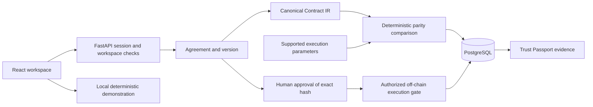

# Where a comparison becomes evidence

Vercel routes API requests to FastAPI and other requests to the Vite frontend. The browser submits agreement text. The server resolves the member and organization from the session, scopes the agreement lookup, derives the supported fields and binds each version to its content hash. Browser-selected personas apply to the local demonstration only.

Verification compares server-derived terms with supported execution parameters. It records the run and its inputs' fingerprints. The Passport reads evidence for a version. Missing evidence and stale evidence are different states. The execution handler separately checks permission, the current version, approval policy and draft state, and records the off-chain transition. PostgreSQL is the deployment store. Disposable SQLite is suitable for the local rehearsal.

An optional Gemini adapter can propose structured data. Model output is untrusted input, since an extraction can omit conditions or misread obligations. Only validated fields enter a comparison. Neither the provider nor a favorable comparison can supply a party's authorization. [Service routing](../vercel.json) · [Parity implementation](../api/app/parity/service.py) · [Execution handler](../api/app/routers/execution.py)
